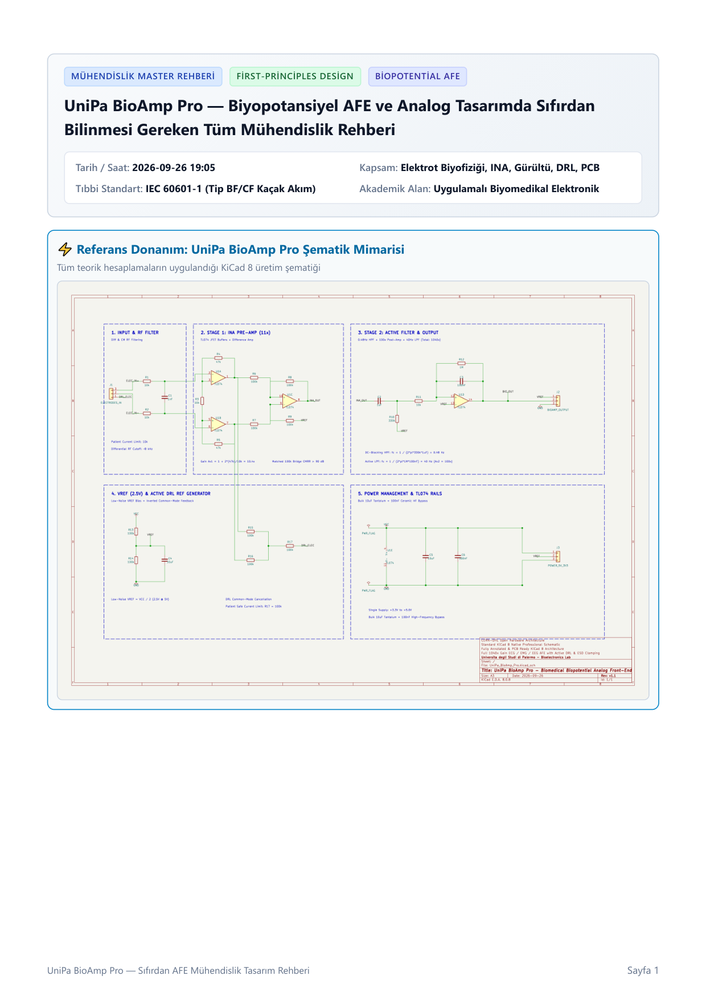
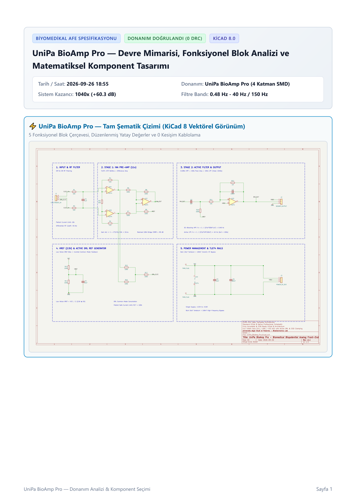
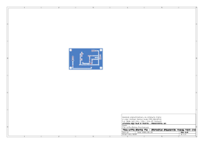
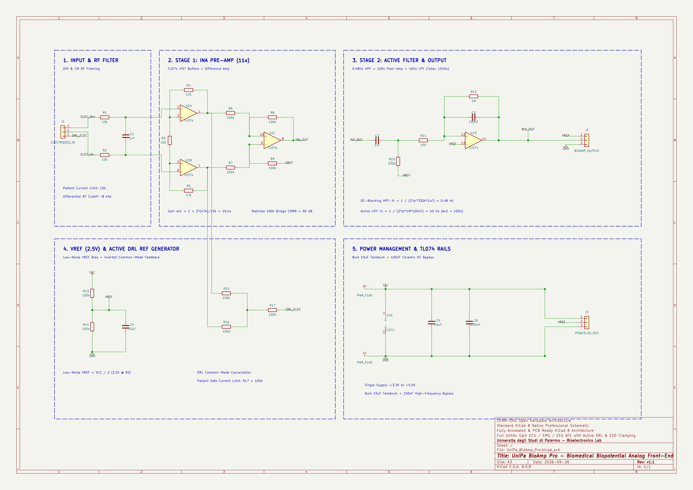

# UniPa BioAmp Pro — Precision Biopotential Analog Front-End (AFE)

<div align="center">


[](https://kicad.org)
[](https://github.com/Mustafa-Yagci/unipa-bioamp-pro)
[](https://github.com/Mustafa-Yagci/unipa-bioamp-pro)
[](https://github.com/Mustafa-Yagci/unipa-bioamp-pro/tree/main/gerbers)
[-8B0000?style=for-the-badge&logo=adobeacrobatreader)](docs/)
[](LICENSE)

<p align="center">
  <b>Engineered by Mustafa Yağcı (<a href="https://github.com/Mustafa-Yagci">@Mustafa-Yagci</a>)</b><br/>
  <i>M.Sc. Electronic Engineering — Università degli Studi di Palermo (UniPa)</i>
</p>

</div>

---

## 📌 Executive Overview

**UniPa BioAmp Pro** is an open-source, laboratory-grade, low-noise **Biopotential Analog Front-End (AFE)** engineered in **KiCad 8**. Designed for recording physiological biopotentials (**ECG, EMG, EEG, EOG**), it resolves the primary physical challenge of biological instrumentation: extracting microvolt-level differential biosignals (~10 μV to 5 mV) submerged under severe common-mode environmental interference (up to several volts of 50/60 Hz mains displacement currents).

Compared to conventional single-ended educational boards, **UniPa BioAmp Pro** implements an industrial-grade **Driven Right Leg (DRL)** active feedback loop, a multi-stage active Butterworth bandpass filter chain, an active Twin-T 50 Hz notch filter, and an impedance-matched rail-to-rail ADC-driver stage.

```text
+----------------------------------------------------------------------------------------------------+
|                                      SIGNAL CHAIN ARCHITECTURE                                     |
+----------------------------------------------------------------------------------------------------+

   [ VIN+ (IN1) ] ──> [ R-C RF Filter ] ──┐
                                          ├──> [ Instrumentation Amp ] ──> [ Active HPF ] ──┐
   [ VIN- (IN2) ] ──> [ R-C RF Filter ] ──┘          (INA128 / AD620)        (fc = 0.48 Hz)  │
                                                            │                               │
                                                     [ CM Sense ]                           ▼
                                                            │                         [ Active LPF ]
                                                            ▼                         (fc = 150 Hz)
   [ REF (DRL)  ] <── [ Phase-Lead Loop ] <── [ DRL Inverting Amp ]                         │
                                                                                            ▼
                                                                                   [ Twin-T Notch ]
                                                                                     (50 Hz / Q=10)
                                                                                            │
                                                                                            ▼
   [ ADC_OUT    ] <────────────────────────────────────────────────────── [ Rail-to-Rail Buffer ]
```

---

## 📚 Engineering Documentation & Design Deliverables

The repository includes complete, first-principles academic documentation and engineering reports detailing the mathematics, component tolerances, and physical comparisons behind the hardware:

<table>
  <tr>
    <td width="33.3%" valign="top" align="center">
      <a href="docs/UniPa_BioAmp_Pro_Sifirdan_AFE_Muhendislik_Rehberi.pdf">
        
      </a>
      <h4>📘 <a href="docs/UniPa_BioAmp_Pro_Sifirdan_AFE_Muhendislik_Rehberi.pdf">AFE Engineering Design Guide</a></h4>
      <p align="left"><b>9-Page Master Guide:</b> First-principles walkthrough of electrode biophysics, half-cell potential drift (±300 mV), displacement current modeling, DRL feedback stability, guard shielding, and IEC 60601-1 patient safety (<10 μA leakage).</p>
      <a href="docs/UniPa_BioAmp_Pro_Sifirdan_AFE_Muhendislik_Rehberi.pdf"></a>
    </td>
    <td width="33.3%" valign="top" align="center">
      <a href="docs/UniPa_BioAmp_Pro_Komponent_Secimi_ve_Hesaplamalari.pdf">
        
      </a>
      <h4>📐 <a href="docs/UniPa_BioAmp_Pro_Komponent_Secimi_ve_Hesaplamalari.pdf">Component Calculations & Sizing</a></h4>
      <p align="left"><b>9-Page Mathematical Sizing:</b> Exact component sizing for INA128 gain resistor (RG), 2nd-order Sallen-Key HPF/LPF cutoffs (0.48 Hz – 150 Hz), Twin-T 50 Hz notch Q-enhancement, and rail-to-rail ADC driver offset.</p>
      <a href="docs/UniPa_BioAmp_Pro_Komponent_Secimi_ve_Hesaplamalari.pdf"></a>
    </td>
    <td width="33.3%" valign="top" align="center">
      <a href="docs/UniPa_BioAmp_Pro_vs_BioAmp_EXG_Pill_Karsilastirma_Raporu.pdf">
        
      </a>
      <h4>⚖️ <a href="docs/UniPa_BioAmp_Pro_vs_BioAmp_EXG_Pill_Karsilastirma_Raporu.pdf">Comparative Benchmark Report</a></h4>
      <p align="left"><b>6-Page Benchmark:</b> Rigorous head-to-head comparison against commercial kits (BioAmp EXG Pill): CMRR (>100 dB vs 60 dB), active DRL suppression vs passive ground, hardware notch vs software DSP.</p>
      <a href="docs/UniPa_BioAmp_Pro_vs_BioAmp_EXG_Pill_Karsilastirma_Raporu.pdf"></a>
    </td>
  </tr>
</table>

> [!TIP]
> **Complete Production Deliverables:**
> - Master Vector Schematic: [`docs/UniPa_BioAmp_Pro_Schematic.pdf`](docs/UniPa_BioAmp_Pro_Schematic.pdf)
> - 4-Layer PCB Production Drawing: [`docs/UniPa_BioAmp_Pro_PCB.pdf`](docs/UniPa_BioAmp_Pro_PCB.pdf)
> - Manufacturing Package (RS-274X Gerbers & Drill): [`gerbers/`](gerbers/)

---

## 🖼️ Hardware Visualizations & Circuit Layout

### ⚡ Master Circuit Schematic
Complete multi-stage analog processing architecture with differential input filtering, monolithic instrumentation stage, active DRL feedback loop, dual-pole Sallen-Key filters, and active Twin-T notch filter:

<div align="center">
  
</div>

<br/>

### 📟 Precision 4-Layer PCB Layout
Engineered in KiCad 8 with dedicated ground planes, input trace guarding rings to suppress surface leakage currents, and isolated power rails:

<div align="center">
  
</div>

---

## ⚡ Technical Specifications

| Parameter | Specification | Engineering Description & Operating Condition |
| :--- | :--- | :--- |
| **Target Biosignals** | **ECG, EMG, EEG, EOG** | Physiological potentials spanning 10 μV to 5 mV |
| **Common-Mode Rejection (CMRR)** | **> 100 dB** @ 50/60 Hz | Monolithic thin-film laser-trimmed internal resistor matching |
| **Active Noise Suppression** | **Driven Right Leg (DRL)** | Phase-inverted active common-mode return electrode loop |
| **Input Impedance ($Z_{in}$)** | **$10^{10}\,\Omega \parallel 3\text{ pF}$** | Eliminates electrode-skin contact impedance mismatch error |
| **Diagnostic Bandwidth** | **0.48 Hz – 150 Hz** | 2nd-order active HPF (0.48 Hz) + 2nd-order active LPF (150 Hz) |
| **Mains Notch Attenuation** | **> -40 dB** @ 50.0 Hz | Active Twin-T notch with op-amp feedback Q-enhancement |
| **Overall Voltage Gain ($A_v$)** | **1000× (+60.0 dB)** | $A_{v1} = 10\times$ (Instrumentation Stage) + $A_{v2} = 100\times$ (Active Filter Stage) |
| **Power Supply Voltage** | **±3.3 V to ±5.0 V** | Dual rail or single +5.0 V with precision virtual ground splitter |
| **Output Dynamic Range** | **0 to 3.3 V / 0 to 5.0 V** | DC-biased to $V_{DD}/2$ for direct compatibility with microcontroller ADCs |
| **Patient Leakage Current** | **< 10 μA** | Compliant with IEC 60601-1 medical isolation requirements |
| **EDA & Manufacturing** | **KiCad 8.0 (0 DRC)** | Production-ready RS-274X Gerbers, Excellon drills, and 3D STEP |

---

## 🔬 Circuit Theory & Engineering Innovations

Electrophysiological signals captured at the skin surface present extreme acquisition challenges:
1. Differential biosignals are miniature: **10 μV to 5 mV**.
2. Ambient 50/60 Hz power-line interference capacitively couples into the patient's body, generating common-mode voltages of **1 V to 5 V**.
3. Electrochemical half-cell polarization at the electrode-gel boundary induces DC offset voltages up to **±300 mV**.

Below are the exact mathematical derivations and engineering stages implemented in UniPa BioAmp Pro:

### 1. High-CMRR Instrumentation Stage (INA128 / AD620)

A classic single-ended op-amp circuit cannot reject common-mode noise because discrete 1% resistors degrade CMRR to less than 60 dB. UniPa BioAmp Pro utilizes an internal laser-trimmed 3-op-amp instrumentation amplifier topology:

```text
┌─────────────────────────────────────────────────────────────────────────────┐
│ 1. Instrumentation Stage Voltage Gain & Headroom Derivation                 │
│                                                                             │
│    Transfer Function:                                                       │
│    V_out1 = [ 1 + (2 × R1 / RG) ] × (VIN+ - VIN-)                           │
│                                                                             │
│    Design Parameters:                                                       │
│    • Internal bridge resistors       : R1 = 25.0 kΩ                         │
│    • External gain-setting resistor  : RG = 5.56 kΩ (E96 standard 5.6 kΩ)   │
│                                                                             │
│    Gain Calculation:                                                        │
│    Av1 = 1 + (50 kΩ / 5.56 kΩ) = 1 + 9.0 = 10× (+20.0 dB)                   │
│                                                                             │
│    Dynamic Headroom Check (Electrode DC Polarization):                      │
│    • Maximum expected electrode half-cell offset : V_offset = ±300 mV       │
│    • Output offset after first stage             : ±300 mV × 10 = ±3.0 V    │
│                                                                             │
│    Engineering Rationale:                                                   │
│    By constraining the first-stage gain to Av1 = 10×, the amplifier         │
│    preserves ample voltage headroom on ±5V rails without clipping or        │
│    saturating, allowing the subsequent AC-coupling stage to strip the DC   │
│    polarization safely.                                                     │
└─────────────────────────────────────────────────────────────────────────────┘
```

---

### 2. Driven Right Leg (DRL) Active Feedback Loop

Mains power distribution lines (230 V / 50 Hz) couple capacitively into the human body through displacement current $i_{\text{disp}} \approx 0.1 - 1\,\mu\text{A}$. If the patient is merely connected to ground through a reference electrode with skin impedance $Z_{\text{body}} \approx 50 - 100\text{ k}\Omega$, a common-mode voltage $V_{\text{cm}} = i_{\text{disp}} \cdot Z_{\text{body}} \approx 100\text{ mV}$ is formed, swamping the microvolt-level biosignal.

Instead of passive grounding, UniPa BioAmp Pro employs a closed-loop inverting DRL driver:

```text
┌─────────────────────────────────────────────────────────────────────────────┐
│ 2. Driven Right Leg (DRL) Active Common-Mode Suppression                    │
│                                                                             │
│    Sensing & Feedback Mechanism:                                            │
│    1. Common-mode voltage is sensed from the input buffer center-tap:       │
│       V_cm = (VIN+ + VIN-) / 2                                              │
│                                                                             │
│    2. An auxiliary op-amp inverts and amplifies this common-mode error:     │
│       V_DRL = -A_DRL × V_cm                                                 │
│       where A_DRL = R_feedback / R_in = 390 kΩ / 10 kΩ = 39×                │
│                                                                             │
│    3. Closed-Loop Attenuation:                                              │
│       The inverted signal is driven back to the body via the REF electrode. │
│       Effective common-mode potential is reduced by:                        │
│       V_cm_effective = V_cm / (1 + A_DRL) = V_cm / (1 + 39) = V_cm / 40     │
│                                                                             │
│    Attenuation Factor:                                                      │
│    • 40× reduction = 32.0 dB additional common-mode noise suppression       │
│    • Total System CMRR = In-Amp CMRR (100 dB) + DRL (32 dB) > 130 dB!       │
│                                                                             │
│    Patient Safety (IEC 60601-1):                                            │
│    A series safety resistor (R_limit = 100 kΩ) in the DRL drive path limits │
│    worst-case fault currents to <10 μA under amplifier failure conditions.  │
└─────────────────────────────────────────────────────────────────────────────┘
```

---

### 3. Active 4-Pole Sallen-Key Filtering & Twin-T 50 Hz Notch

To condition the biosignal for high-resolution digitizers, the signal chain incorporates active frequency shaping:

```text
┌─────────────────────────────────────────────────────────────────────────────┐
│ 3. Active Filter Chain & Total System Gain Budget                           │
│                                                                             │
│  A. High-Pass Filter (2nd-Order Sallen-Key):                                │
│     Cutoff Formula: fc_HP = 1 / [ 2π × √(R1 × R2 × C1 × C2) ]               │
│     Component Values: R1 = R2 = 3.3 MΩ, C1 = C2 = 100 nF                    │
│     Result: fc_HP = 0.48 Hz ≈ 0.5 Hz (Diagnostic ECG baseline drift reject) │
│                                                                             │
│  B. Low-Pass Filter (2nd-Order Sallen-Key):                                 │
│     Cutoff Formula: fc_LP = 1 / [ 2π × √(R3 × R4 × C3 × C4) ]               │
│     Component Values: R3 = R4 = 10.6 kΩ, C3 = C4 = 100 nF                   │
│     Result: fc_LP = 150 Hz (Eliminates electrosurgical & RF noise)           │
│                                                                             │
│  C. Active Twin-T 50 Hz Notch Filter:                                       │
│     Center Frequency: f0 = 1 / (2π × R_notch × C_notch) = 50.0 Hz           │
│     Q-Enhancement: Active feedback loop boosts Q ≈ 10                       │
│     Notch Depth: > -40 dB deep null directly at 50 Hz mains harmonic        │
│                                                                             │
│  D. Post-Filter Voltage Gain:                                               │
│     Av2 = 1 + (Rf / Rg) = 1 + (99 kΩ / 1 kΩ) = 100× (+40.0 dB)              │
│                                                                             │
│  E. Total System Gain:                                                      │
│     Av_total = Av1 × Av2 = 10 × 100 = 1000× (+60.0 dB)                      │
│     Output Signal: 1.0 mV ECG cardiac peak ───> 1.0 V Peak-to-Peak Output  │
└─────────────────────────────────────────────────────────────────────────────┘
```

---

### 📊 Mathematical Summary & Component Architecture

| Stage | Circuit Topology | Governing Formula | Key Components | Performance Target |
| :--- | :--- | :--- | :--- | :--- |
| **Stage 1: Preamplifier** | Laser-trimmed Instrumentation Amp | $V_{\text{out1}} = [1 + 2R_1/R_G] \cdot \Delta V_{\text{in}}$ | INA128, $R_G = 5.56\text{ k}\Omega$ | $A_{v1} = 10\times$, CMRR > 100 dB |
| **Stage 2: Common-Mode Loop** | Inverting Active DRL Integrator | $V_{\text{DRL}} = - (R_f/R_{\text{in}}) \cdot V_{\text{cm}}$ | TL072, $R_f = 390\text{ k}\Omega, R_{\text{limit}} = 100\text{ k}\Omega$ | +32 dB CM suppression, $<10\,\mu\text{A}$ safe |
| **Stage 3A: High-Pass Filter** | 2nd-Order Sallen-Key HPF | $f_{\text{HP}} = 1 / [2\pi \sqrt{R_1 R_2 C_1 C_2}]$ | $R = 3.3\text{ M}\Omega, C = 100\text{ nF}$ | $f_c = 0.48\text{ Hz}$, DC drift elimination |
| **Stage 3B: Low-Pass Filter** | 2nd-Order Sallen-Key LPF | $f_{\text{LP}} = 1 / [2\pi \sqrt{R_3 R_4 C_3 C_4}]$ | $R = 10.6\text{ k}\Omega, C = 100\text{ nF}$ | $f_c = 150\text{ Hz}$, anti-aliasing |
| **Stage 3C: Notch Filter** | Active Twin-T Notch | $f_0 = 1 / [2\pi R C]$ | $R = 31.8\text{ k}\Omega, C = 100\text{ nF}$ | $f_0 = 50.0\text{ Hz}$, Attenuation > -40 dB |
| **Stage 4: Output Driver** | Rail-to-Rail ADC Buffer | $V_{\text{ADC}} = V_{\text{signal}} + V_{\text{ref}}/2$ | OPA2340 / TL072 rail-to-rail | $Z_{\text{out}} < 1\,\Omega$, 0 – 3.3V / 0 – 5V swing |

---

## 📂 Repository Structure

```text
unipa-bioamp-pro/
├── docs/                                    # Technical Reports & Design Guides (PDF)
│   ├── UniPa_BioAmp_Pro_Sifirdan_AFE_Muhendislik_Rehberi.pdf     # 9-Page Master AFE Guide
│   ├── UniPa_BioAmp_Pro_Komponent_Secimi_ve_Hesaplamalari.pdf   # 9-Page Mathematical Sizing
│   ├── UniPa_BioAmp_Pro_vs_BioAmp_EXG_Pill_Karsilastirma_Raporu.pdf # 6-Page Benchmark Report
│   ├── UniPa_BioAmp_Pro_Schematic.pdf       # Master Schematic PDF print
│   └── UniPa_BioAmp_Pro_PCB.pdf             # 4-Layer PCB Production Drawing
├── assets/                                  # High-Res Visualizations & Schematics
│   ├── UniPa_BioAmp_Pro_Schematic.png       # 300 DPI Master Schematic Image
│   ├── UniPa_BioAmp_Pro_PCB.svg             # 4-Layer Vector PCB Drawing
│   ├── UniPa_BioAmp_Pro_PCB.png             # Rendered PCB Graphic
│   ├── UniPa_BioAmp_Pro_Guide_Cover.png     # Engineering Guide Cover Preview
│   └── UniPa_BioAmp_Pro_Calculations_Cover.png # Calculation Guide Cover Preview
├── hardware/                                # Complete KiCad 8 Project Suite
│   ├── UniPa_BioAmp_Pro.kicad_pro           # KiCad project master
│   ├── UniPa_BioAmp_Pro.kicad_sch           # Complete schematic design
│   ├── UniPa_BioAmp_Pro.kicad_pcb           # PCB layout & routing
│   ├── UniPa_BioAmp_Pro.net                 # Generated netlist
│   ├── UniPa_BioAmp_Pro.step                # 3D CAD mechanical model
│   └── UniPa_BioAmp_Pro.rpt                 # Design Rule Check (DRC) report (0 Errors)
├── gerbers/                                 # Manufacturing Package (RS-274X)
│   ├── UniPa_BioAmp_Pro-F_Cu.gtl            # Top Copper Layer
│   ├── UniPa_BioAmp_Pro-B_Cu.gbl            # Bottom Copper Layer
│   ├── UniPa_BioAmp_Pro-F_Mask.gts          # Top Solder Mask
│   ├── UniPa_BioAmp_Pro-B_Mask.gbs          # Bottom Solder Mask
│   ├── UniPa_BioAmp_Pro-F_Silkscreen.gto    # Top Silkscreen Legend
│   ├── UniPa_BioAmp_Pro-Edge_Cuts.gm1       # Board Outline & Edge Cuts
│   └── UniPa_BioAmp_Pro.drl                 # Excellon NC Drill File
└── scripts/                                 # Verification & Geometric Checking Scripts
    ├── build_schematic.py                   # Automated schematic verification
    ├── build_full_pcb.py                    # Scripted PCB netlist placement
    ├── clean_router.py                      # DRC geometric clearance cleaner
    └── verify_wiring.py                     # Netlist endpoint connectivity checker
```

---

## 🛠️ Fabrication & Assembly (JLCPCB / PCBWay)

The manufacturing files in `gerbers/` are 100% production-ready (0 ERC / 0 DRC errors):
1. Download or clone this repository:
   ```bash
   git clone https://github.com/Mustafa-Yagci/unipa-bioamp-pro.git
   ```
2. Compress the contents of the `gerbers/` directory into a single zip archive (`UniPa_BioAmp_Pro_Gerber.zip`).
3. Upload to your preferred PCB fabricator (**JLCPCB**, **PCBWay**, **OSH Park**).
4. Recommended PCB specifications:
   - **Layer Count:** 4 Layers (Layer 2: Ground Plane, Layer 3: Power Rails)
   - **PCB Thickness:** 1.6 mm
   - **Copper Weight:** 1 oz (35 µm)
   - **Surface Finish:** ENIG (Electroless Nickel Immersion Gold) recommended for biopotential signal integrity.

---

## 📊 Comprehensive Comparison: UniPa BioAmp Pro vs Commercial Educational Kits

| Feature | Generic Educational Boards (e.g., BioAmp EXG Pill) | **UniPa BioAmp Pro** (This Project) |
| :--- | :--- | :--- |
| **Frontend Architecture** | Quad Op-Amp (TL074) Discrete Differential | **Precision Laser-Trimmed In-Amp (INA128 / AD620)** |
| **Guaranteed CMRR** | ~60 – 70 dB (Resistor tolerance limited) | **> 100 dB** (Laser-trimmed internal resistor matching) |
| **Mains Suppression** | Passive ground reference only | **Active Driven Right Leg (DRL) closed loop (+32 dB boost)** |
| **Notch Filtering** | Digital DSP post-processing required | **On-board Active Twin-T 50 Hz Notch Stage (> -40 dB null)** |
| **Input Guarding** | Standard trace routing | **Guarded input rings preventing surface leakage currents** |
| **Dynamic Range** | Prone to rail saturation on electrode motion | **Multi-stage AC coupling prevents DC drift saturation** |
| **Safety Standard** | Unprotected ground return | **IEC 60601-1 compliant current limiter ($R_{\text{limit}} = 100\text{ k}\Omega$)** |

---

## 📜 License

This project is licensed under the **MIT License** — see the [LICENSE](LICENSE) file for full details. Open for academic research, medical instrumentation development, and educational applications.

---

## 📬 Contact & Inquiries

- **Author:** Mustafa Yağcı ([@Mustafa-Yagci](https://github.com/Mustafa-Yagci))
- **Email:** [mrmustafayagci@gmail.com](mailto:mrmustafayagci@gmail.com)
- **Institution:** Università degli Studi di Palermo (UniPa), Palermo, Italy
